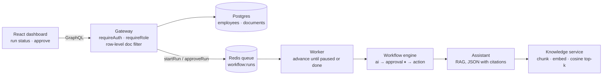

# Enterprise Workflow Platform

**An internal AI platform design: a role-aware GraphQL gateway over company data, a grounded RAG assistant, and a data-driven workflow engine that pauses for human approval — with a Redis job queue, audit log, and usage/cost metrics.**

Enterprises want employees to use AI against internal documents and processes without leaking data across departments or letting an LLM take irreversible actions on its own. This project sketches the platform that makes that safe: one GraphQL front door that enforces permissions per row, an assistant that must cite its sources, and workflows where AI drafts and humans approve before anything is sent.

TypeScript (Node) for the gateway, workflow engine, and queue; Python for the knowledge and assistant services; React for the dashboard.

> **Status: architectural skeleton.** The core logic is written and the workflow engine runs, but the server entry points, persistence for workflow runs, and build configuration aren't in the repository yet. See [Status](#status).



## Key ideas

- **One front door with fail-closed authorization.** Every resolver reads the caller from request context; `requireAuth` and `requireRole` throw GraphQL `UNAUTHENTICATED`/`FORBIDDEN` errors. Roles are ranked (`EMPLOYEE < MANAGER < ADMIN`), so a role check is one comparison.
- **Row-level document visibility.** Documents carry a `visible_to` department list. The `documents` query filters every row against the caller — admins see everything, others see unrestricted docs or ones targeting their department.
- **Workflows are data.** A workflow is an ordered list of `ai`, `approval`, and `action` steps. The engine is a small state machine with injected handlers: it runs a step, records its output, and advances — or pauses with `awaiting_approval` at an approval step.
- **Humans gate side effects.** Starting a run is open to any employee; approving one requires `MANAGER` or above. Action handlers are idempotent per `runId:stepId`, so a retried run doesn't perform the same side effect twice.
- **Async by default.** Mutations enqueue onto a Redis list and return; a separate worker uses blocking `BRPOP` and drives each run until it pauses or completes.
- **Grounded assistant.** Answers come back as validated JSON — `text`, `cited_doc_ids`, `grounded` — and the system prompt requires `grounded: false` rather than invented facts. Documents are split into 600-word chunks with 80-word overlap and ranked by cosine similarity on OpenAI embeddings.
- **Cost and reliability controls.** Transient API errors retry with exponential backoff plus jitter; identical question/context pairs are cached by hash; harder requests ("draft", "compare", "analyze", "why") route to a larger model.
- **Governance signals.** Prometheus counters for usage by assistant and workflow, latency, failures by stage, LLM spend by model, cache hits, and a pending-approvals gauge. The audit log is designed as insert-only, enforced by database grants.

## Workflow engine in action

A three-step refund workflow driven by `advance()` with the bundled handlers (run with Node 22):

```text
triage (ai) → approve (approval) → send (action)

run 1: status=awaiting_approval  cursor=1  outputs=[triage]
after approval:
run 2: status=completed           send → {"status":"performed","key":"r1:send"}
```

## Layout

| Path | Purpose |
|---|---|
| `gateway/schema.graphql` | Public contract: `Employee`, `Document`, `WorkflowRun`; `me`, `documents`, `run`, `startRun`, `approveRun` |
| `gateway/` | Request context, permission helpers, and resolvers |
| `services/` | Typed repositories over Postgres for employees and documents |
| `workflow/` | Step and run types, the engine, and `ai`/`action` handlers |
| `queue/` | Redis enqueue/dequeue and the worker loop |
| `knowledge/` | Chunking and the in-memory embedding retriever (Python) |
| `assistant/` | Grounded answering, retries, caching, model routing (Python) |
| `platform/` | Audit logging and Prometheus metrics (Python) |
| `web/src/` | Dashboard, approve button, and GraphQL client |
| `db/schema.sql` | `employees` and `documents` tables |
| [RUNBOOK.md](RUNBOOK.md) | Operations guide |

## Status

- **Missing modules:** `workflow/store` (`createRun`, `loadRun`, `markApproved`, `saveRun`, `loadWorkflow`), `gateway/server`, `gateway/types`, and the Python `db_async` helper.
- **No build setup:** no `package.json`, `tsconfig.json`, or `Dockerfile` for the root or `web/`, so `docker compose up` can't build the services.
- **Schema gaps:** there's no `audit_log` or workflow-runs table in `db/schema.sql`.
- Per-step `approverRole` is defined on workflow steps but not yet enforced; `approveRun` always requires `MANAGER`.
- The retriever and response cache are in memory.
